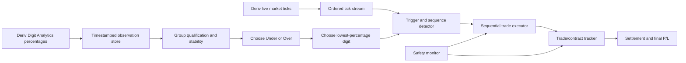
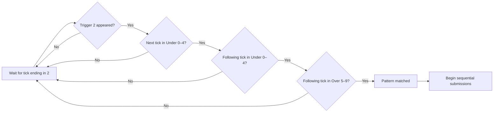
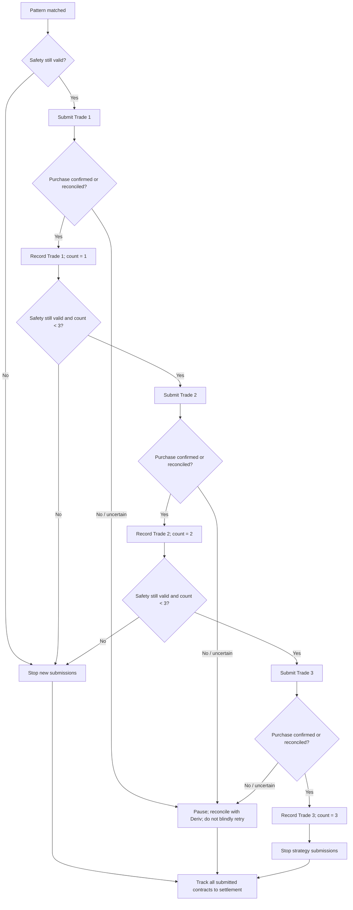

# TradeBridge Digit Analytics Trading Algorithm

> **Status:** Strategy specification — not implementation code. This document records the agreed rules, identifies unresolved decisions, and defines safe behaviour expected before implementation. It does not claim the strategy is profitable. Digit frequencies and historical patterns do not guarantee the next tick.
>
> **Scope:** Deriv digit contracts using two data streams: Digit Analytics percentages and live market ticks. This strategy specification does not authorize real-account execution. TradeBridge's existing real-money execution restrictions remain in force.

## 1. Purpose and operating principles

The algorithm uses Digit Analytics percentages to choose a candidate class (Under or Over), selects the lowest-percentage digit in that class as a trigger, waits for a specified sequence in live market ticks, then submits up to three trades **consecutively, never simultaneously**. It monitors safety conditions during execution and tracks every submitted contract through settlement even after the strategy session stops.

Core principles:

1. A Start press creates a fresh strategy session; it never resumes old strategy observations or sequence progress.
2. Percentage updates and market ticks are different events and must not be conflated.
3. Under and Over are evaluated independently from the same timestamped percentage feed.
4. The entry sequence is checked against ordered live ticks, not percentage updates.
5. Trades are submitted sequentially. An uncertain purchase acknowledgement must be reconciled before retrying.
6. Stopping the strategy does not discard or stop tracking already-submitted contracts.
7. Real-money trading remains disabled unless separately authorized by the product's server-side safety architecture.

## 2. User inputs and session state

Before Start, the user configures:

- **Market/symbol:** the Deriv market to observe.
- **Stake:** amount for each submitted trade.
- **Contract duration:** duration for each submitted trade.
- **Start:** begins a fresh evaluation session.

At session start, initialize the following state:

| State | Initial value | Purpose |
|---|---|---|
| `sessionId` | New unique ID | Separates this evaluation from prior sessions |
| `tradeSubmissionCount` | `0` | Counts confirmed/accepted submissions for the three-trade limit |
| `selectedGroup` | `null` | `UNDER` or `OVER` after selection |
| `triggerDigit` | `null` | Lowest-percentage digit in the selected group |
| `sequenceState` | `WAITING_FOR_TRIGGER` | Entry-pattern progress |
| `observationStartedAt` | Start timestamp | Establishes the initial 10-second window |
| `percentageObservations` | Empty for this session | Timestamped percentage history for qualification |
| `safetyState` | `ACTIVE` | Whether further submissions are permitted |

**Session reset boundary:** reset strategy-local state on every Start. Do not erase or reset trade records belonging to earlier sessions. An independent trade tracker must continue handling contracts that remain open or whose settlement is pending.

## 3. Data streams and timestamp discipline

### 3.1 Digit Analytics percentage stream

For every valid percentage update, record the timestamp and percentage for each digit `0` through `9`. Do not invent updates for digits whose values were not provided. Missing, stale, malformed, or incomplete data must not be interpreted as stable data.

### 3.2 Live tick stream

For each actual market tick, preserve its arrival/order metadata and extract the last digit from the correctly normalized quoted price. Use the market's documented precision; do not derive the last digit by naïvely converting a floating-point number to text if that could alter trailing zeros or decimal precision.

### 3.3 The streams are not interchangeable

- A percentage update is not a tick.
- One tick may arrive without a percentage update.
- One percentage update may summarize a period containing multiple ticks.
- Sequence detection consumes ordered ticks only.
- Qualification and stability checks consume timestamped percentage observations only.



## 4. Initial 10-second observation window

Immediately after Start, begin observing percentage updates. The initial observation window lasts 10 seconds; the number of ticks or percentage updates received during it is not fixed.

During these 10 seconds:

1. Record every valid percentage update and timestamp.
2. Collect the observed values for each digit independently.
3. Evaluate Under digits `0–4` and Over digits `5–9` separately.
4. Apply both the percentage-threshold test and the stability-spread test.
5. Do not submit a trade during this initial assessment.

If data is incomplete or stale, the algorithm must fail closed for qualification: it must not claim that a group is stable based on missing updates.

## 5. Digit groups

| Group | Digits | Direction used if selected |
|---|---|---|
| **Under** | `0, 1, 2, 3, 4` | Under / `DIGITUNDER` contract |
| **Over** | `5, 6, 7, 8, 9` | Over / `DIGITOVER` contract |

The strategy selects one group, then chooses the single digit with the lowest percentage within that group as the trigger digit. It does not select the direction manually from a user control.

## 6. Percentage-threshold qualification

For each group, inspect the current qualifying percentage observations for its five digits.

A group passes the threshold test only if all of the following are true:

- Every digit is below `10.0%`, except that at most one digit may be `>= 10.0%` and strictly `< 10.5%`.
- If two or more digits are `>= 10.0%`, the group fails.
- If any digit is `>= 10.5%`, the group fails.

Examples:

| Five digit percentages in a group | Threshold result | Reason |
|---|---|---|
| `8.2, 9.1, 9.5, 9.7, 9.9` | Pass | All are below 10% |
| `8.2, 9.1, 9.5, 9.7, 10.3` | Pass | Exactly one is from 10% to below 10.5% |
| `8.2, 9.1, 9.5, 10.1, 10.3` | Fail | Two digits are at least 10% |
| `8.2, 9.1, 9.5, 9.7, 10.5` | Fail | One digit is at least 10.5% |

The threshold test and stability test are independent. A group must pass both.

## 7. Stability-spread test

For each digit `d`, calculate its observed spread during the initial 10-second window:

`spread(d) = maximum observed percentage(d) - minimum observed percentage(d)`

A digit passes stability when:

`spread(d) <= 0.5 percentage points`

All five digits in a group must pass. A spread of exactly `0.5` percentage points passes; a spread greater than `0.5` fails.

| Observed minimum → maximum | Spread | Result |
|---|---:|---|
| `5.5% → 5.7%` | `0.2` points | Pass |
| `5.5% → 6.0%` | `0.5` points | Pass |
| `5.5% → 6.1%` | `0.6` points | Fail |

This is a **maximum-to-minimum range** test, not a limit of 0.1 points per update. A single digit that lacks enough valid observations to assess stability must not automatically pass.

## 8. Qualification and group-selection decision

Under and Over are evaluated independently against the same percentage stream.

| Under | Over | Action |
|---|---|---|
| Pass | Fail | Select Under |
| Fail | Pass | Select Over |
| Fail | Fail | Continue observing until a group qualifies |
| Pass | Pass | Do not trade yet; wait for another valid percentage observation and reassess |

If both qualify, do not arbitrarily choose one. Continue observing and reevaluate. The implementation must define a consistent timestamp/window policy for this continuing observation; see **Open decisions** below.

Once exactly one group qualifies, select the digit with the lowest percentage in that group and store it as `triggerDigit`.

**Unresolved tie:** if two or more digits share the same lowest percentage, no tie-break rule has yet been agreed. Do not silently assume one.

## 9. Trigger and sequence logic

The trigger digit identifies the beginning of an entry attempt; it is not by itself a completed pattern.

Required pattern:

`TRIGGER → S → S → O`

Where:

- `TRIGGER` is the selected trigger digit appearing as a live tick's last digit.
- `S` is a digit belonging to the selected group.
- `O` is a digit belonging to the opposite group.

Thus, when Under is selected, the two middle digits must each be in `0–4`, followed by a digit in `5–9`. When Over is selected, the two middle digits must each be in `5–9`, followed by a digit in `0–4`.

### Example: Under selected, trigger digit `2`



Concrete example:

- Trigger `2` appears.
- Next digits: `1`, then `4`, then `7`.
- `1` and `4` are Under digits; `7` is an Over digit.
- The pattern matches.

Failure example:

- Trigger `2` appears, but the next digit is `6`.
- The attempt fails immediately.
- Return to waiting for `2` to appear again.
- Start a fresh pattern attempt only after the trigger reappears.

Digits from a failed attempt must not be combined with digits from a later attempt. Use actual tick order, and handle duplicate or out-of-order tick messages defensively.

## 10. Trade submission: three consecutive trades

After a complete pattern matches, submit up to three trades **sequentially**. They must not be launched concurrently as three simultaneous purchase requests.

Each trade uses the stake and duration configured before Start. The selected group determines the contract direction. The strategy does not require the entry pattern to repeat between the three trades.



### Submission-count rules

- Count a trade only after its purchase is confirmed or otherwise reconciled as accepted by Deriv.
- Do not count an unconfirmed request as a successful trade.
- If an acknowledgement is uncertain, pause the sequence and reconcile open contracts/statement activity before any retry. An absent UI response does not prove the purchase failed.
- Before each next submission, re-check the safety gate.
- Stop after three confirmed submissions or immediately after a safety breach, whichever occurs first.

**Consecutive does not yet mean “wait for settlement.”** The agreed requirement is sequential submissions, not simultaneous submissions. It remains undecided whether Trade 2 waits only for Trade 1's purchase acknowledgement or waits for Trade 1 to settle; the implementation must not invent this policy.

## 11. Safety monitoring and stop behaviour

Safety monitoring remains active during sequence detection and trade submission. If a relevant percentage safety condition is breached while submitting the three trades:

1. Stop any further trade submissions immediately.
2. Mark the strategy session as stopped.
3. Do not cancel or forget already accepted contracts merely because the strategy stopped.
4. Continue tracking every submitted contract through settlement.
5. Require a fresh Start to run a new strategy evaluation.

The initial stability rule (`spread <= 0.5 points over 10 seconds`) is explicitly defined. However, the exact live breach rule—what values are monitored after qualification, what threshold triggers a stop, and whether it applies to the selected group only or both groups—has not yet been fully specified. Keep this as a required decision, not an implicit guess.

## 12. Session lifecycle and separate contract tracking

```mermaid
stateDiagram-v2
  [*] --> FreshSession: User presses Start
  FreshSession --> InitialObservation: Reset strategy-local state
  InitialObservation --> Evaluating: 10 seconds elapsed
  Evaluating --> ObservingMore: Neither group qualifies
  ObservingMore --> Evaluating: New valid percentage update
  Evaluating --> WaitingForResolution: Both groups qualify
  WaitingForResolution --> Evaluating: New valid percentage update
  Evaluating --> WaitingForTrigger: Exactly one group qualifies
  WaitingForTrigger --> CheckingPattern: Trigger digit appears
  CheckingPattern --> WaitingForTrigger: Pattern fails; wait for trigger again
  CheckingPattern --> SubmittingTrades: Pattern matches
  SubmittingTrades --> Stopped: Three trades submitted
  SubmittingTrades --> Stopped: Safety breach or unreconciled request
  Stopped --> TrackingSettlement: Preserve and reconcile submitted contracts
  TrackingSettlement --> [*]: All known contracts resolved/recorded
```



A new Start resets the **strategy state**, not the account's contract history. The trade tracker must be independent enough to continue receiving or recovering open-contract and settlement updates after the strategy stops, the user starts another session, or a WebSocket reconnects.

Session stop conditions:

- **Normal completion:** three trades have been submitted and confirmed; no new strategy submissions are allowed for that session.
- **Safety stop:** a defined safety breach occurs; stop remaining submissions.
- **Uncertain purchase:** pause further submissions until reconciliation resolves whether the request was accepted.
- **User stop/disconnection:** do not start new submissions while state is uncertain; reconcile in-flight requests and continue tracking known contracts where connectivity allows.

## 13. Contract records and settlement

Maintain a durable record for each accepted trade, at minimum:

- Strategy session ID and sequence number (1, 2, or 3).
- Market symbol, selected group, contract type, trigger digit and matched tick-sequence evidence.
- Configured stake and duration.
- Request identifier and provider contract ID, when available.
- Submission timestamp and purchase acknowledgement/reconciliation status.
- Open/settled status, final outcome, and final profit/loss as confirmed by Deriv.
- Stop reason if the session ended before all three trades were submitted.

Use provider-authoritative contract updates and settlement/statement reconciliation. Do not infer a final profit/loss from a transient UI state. Avoid duplicate submissions after timeouts or connection failures.

## 14. High-level algorithm pseudocode

```text
ON USER START:
    create new session ID
    reset session submission counter to 0
    clear selected group, trigger digit, and sequence state
    start a 10-second percentage observation window
    continue independent tracking of contracts from older sessions

    collect timestamped percentage updates and ordered market ticks
    at 10 seconds:
        evaluate Under threshold + stability
        evaluate Over threshold + stability

    repeat:
        if neither group qualifies:
            continue observing and reevaluate
        else if both groups qualify:
            wait for another valid percentage update and reevaluate
        else:
            select the sole qualifying group
            choose its lowest-percentage digit as trigger
            break

    while session is active and confirmed submissions < 3:
        monitor safety conditions
        if safety breached:
            stop further submissions
            break

        wait for trigger digit in ordered live ticks
        check the next three ticks against S, S, O

        if pattern fails:
            reset pattern attempt
            wait for trigger digit again
            continue

        if pattern matches:
            for each remaining trade, in order, up to 3:
                re-check safety
                if safety breached: stop submission loop
                submit one purchase request (not concurrently)
                if acknowledgement uncertain:
                    pause and reconcile; never blindly retry
                if purchase confirmed:
                    record contract and increment submission count

    stop new strategy submissions
    keep tracking every submitted contract until settlement is recorded
```

This pseudocode intentionally leaves the live safety-breach predicate, percentage-window policy after the initial 10 seconds, lowest-percentage tie-break, and trade-to-trade wait policy explicit as unresolved decisions.

## 15. Unresolved decisions before implementation

These questions must be answered rather than silently filled in by code:

1. **Lowest-percentage tie:** what should happen if two or more digits in the chosen group have the same lowest percentage?
2. **Post-window stability:** after the first 10 seconds, when neither group qualifies or both qualify, should stability use a rolling 10-second window, a new 10-second window, or another explicitly defined window?
3. **Live safety breach:** which percentage limits trigger a stop after group selection, and do they apply to the selected group or both groups?
4. **Trade sequencing:** should the next purchase begin after the previous purchase is acknowledged, or only after the previous contract settles? Both are sequential; they have materially different exposure and timing.
5. **Data quality/connection loss:** how long may percentage data or ticks be stale before the strategy pauses, and what recovery condition permits it to continue?
6. **Pattern overlap:** after a failed pattern, the agreed rule is to wait for the trigger digit again. Confirm whether a tick that could also be interpreted as a new trigger is eligible immediately after failure, or only subsequent ticks are eligible.

## 16. Testing and rollout gates

Before considering live use, test in replay/simulation and Deriv Demo. Do not infer profitability from the strategy's definition alone.

Required scenarios include:

- Under passes / Over fails; Over passes / Under fails.
- Both fail and observation continues.
- Both pass and no trade is opened while selection is ambiguous.
- Threshold boundary values at `10.0%` and `10.5%`.
- Stability spreads of exactly `0.5` and greater than `0.5` percentage points.
- Missing, stale, duplicate, and out-of-order percentage updates/ticks.
- Trigger appears; sequence succeeds; sequence fails and requires a new trigger.
- Safety breach before Trade 1, between submissions, and after all submissions.
- Purchase timeout with accepted contract, rejected purchase, and unknown outcome.
- Restart/disconnect while contracts are open; recover and track settlement without duplicate buys.
- A fresh Start while older-session contracts remain unsettled.

Real-account execution must remain disabled unless the separate server-side execution gateway, risk enforcement, and order reconciliation requirements are satisfied. A successful build or demo run is not evidence that the strategy is profitable or safe for real-money use.
